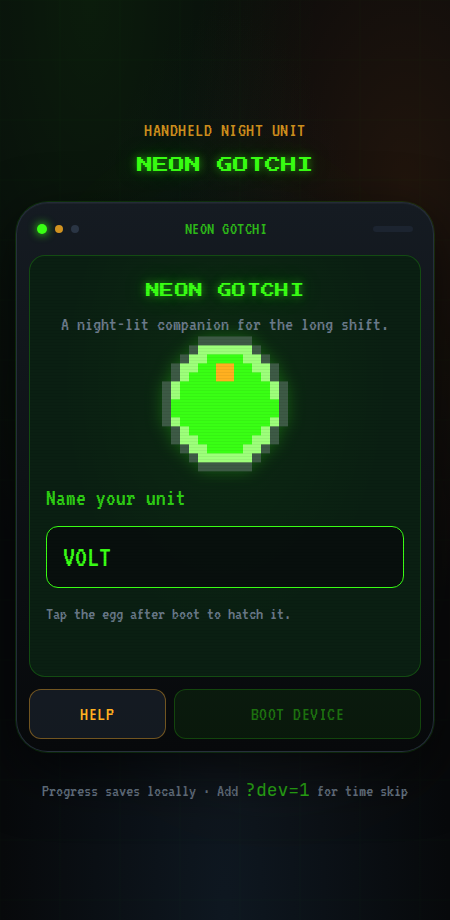
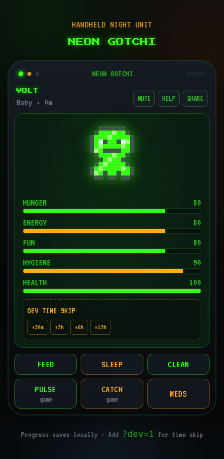
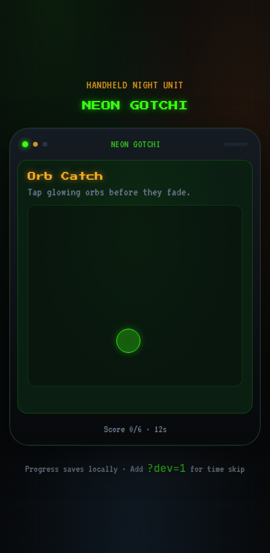
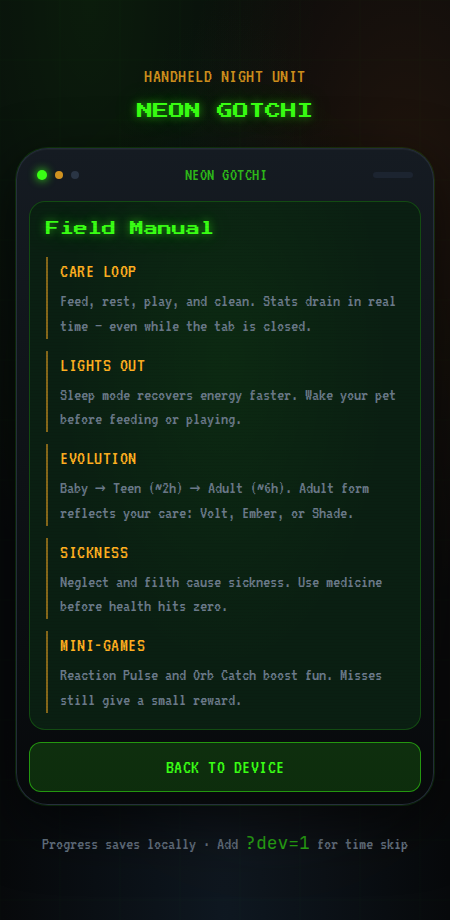
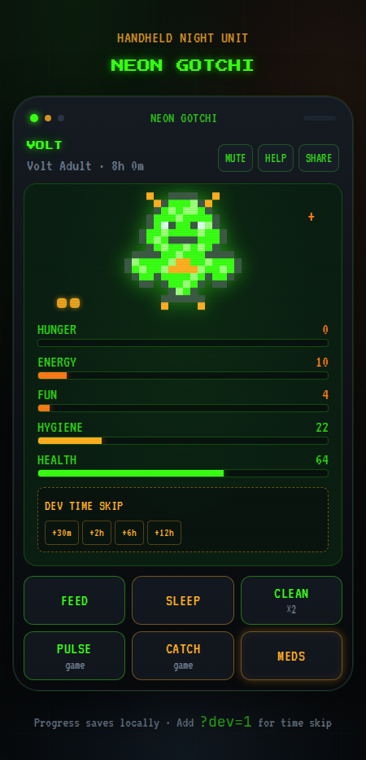
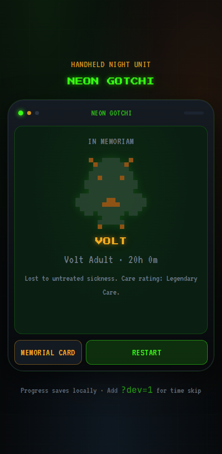

# Neon Gotchi

A moody, night-lit virtual pet — the spiritual reboot of a 2020 vanilla-JS Tamagotchi class project. Built as a fully static Vite + React + TypeScript game with Tailwind CSS and Framer Motion.



## Features

- **Naming screen** (no `prompt()`) and tap-to-hatch egg
- **Pixel-art pet** with idle / eating / sleeping / playing / sick / happy / dead animations
- **Evolution**: egg → baby → teen → adult (Volt / Ember / Shade based on care quality)
- **Live stats**: hunger, energy, fun, hygiene, health — drain in real time and catch up while the tab is closed
- **Care actions**: feed, sleep (lights-off), clean poop, medicine
- **Mini-games**: Reaction Pulse and Orb Catch to raise fun
- **Sickness & death** with a memorial screen and restart
- **Chiptune SFX** via Web Audio API + mute toggle
- **localStorage** save/resume
- **Share card** (Web Share API with PNG download fallback)
- **Dev time-skip** via `?dev=1` for testing evolution and death

## Screenshots

| Naming | Care | Mini-game |
| --- | --- | --- |
|  |  |  |

| Help | Evolved adult | Memorial |
| --- | --- | --- |
|  |  |  |

## Stack

- Vite + React 19 + TypeScript
- Tailwind CSS v4
- Framer Motion
- Self-hosted pixel fonts: **Press Start 2P** (headings) + **VT323** (body/UI) — no runtime Google Fonts
- Web Audio API / Web Share API / localStorage

## Local development

```bash
npm ci
npm run dev
```

Open the URL Vite prints (usually `http://localhost:5173`).

Add `?dev=1` to unlock the on-device time-skip controls:

```
http://localhost:5173/?dev=1
```

### Scripts

| Command | Purpose |
| --- | --- |
| `npm run dev` | Dev server |
| `npm run build` | Typecheck + production build → `dist/` |
| `npm run lint` | Oxlint |
| `npm run preview` | Preview the production build |

## Deploy on Render (static site)

This repo includes a Blueprint at [`render.yaml`](./render.yaml).

**Exact settings:**

| Setting | Value |
| --- | --- |
| Service type | Static Site |
| Build command | `npm ci && npm run build` |
| Publish directory | `dist` |
| SPA rewrite | `/*` → `/index.html` |

### Option A — Blueprint

1. Push this repo to GitHub
2. In Render: **New → Blueprint** and select the repo
3. Apply the `neon-gotchi` static service from `render.yaml`

### Option B — Manual static site

1. **New → Static Site**
2. Connect the repo
3. Build command: `npm ci && npm run build`
4. Publish directory: `dist`
5. Add a rewrite rule: source `/*` → destination `/index.html`

No server runtime is required — the build emits a static SPA.

## Gameplay tuning

Drain rates are intentionally gentle for casual check-ins across a normal day (roughly 8–12+ hours of neglect before death, sooner if multiple vitals crash and sickness goes untreated). Evolution gates: teen at ~2h of life, adult at ~6h.

## License

Original student project revived for fun — pixel sprites and code are original to this reboot.
